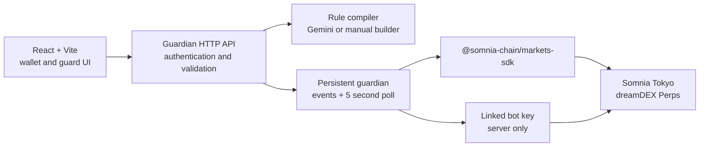

<a id="top"></a>

<h1 align="center">Dexter</h1>

<p align="center">
  <strong>Protect a perps position before it reaches liquidation.</strong><br>
  Describe a rule in plain English, review it, and let a constrained guardian notify you or partially close the live position.
</p>

<p align="center">
  <a href="#x-running-it"><strong>Run it locally ↗</strong></a>
  &nbsp; · &nbsp;
  <a href="#xi-what-works-today">What works today</a>
  &nbsp; · &nbsp;
  <a href="#ix-repository-map">Repository map</a>
</p>

<p align="center">
  <sub>SOMNIA TOKYO / DREAMDEX PERPS / REACTIVITY / REACT + VITE</sub>
</p>

---

Dexter is a position guardian for dreamDEX perpetuals on Somnia Tokyo/Hideki
testnet. It is not a general trading bot. A guard contains one supported
trigger and one supported action, is validated before it is saved, and is
evaluated against the owner's live position.

> **Dexter does not place stop-loss or take-profit orders.**
>
> A linked bot key cannot place reduce-only TP/SL on dreamDEX. When a partial
> close guard fires, Dexter prepares a bounded normal order for the live
> position. Dry-run mode is the default and never broadcasts a transaction.

| What the guardian observes | What it can do |
| :--- | :--- |
| Liquidation distance and mark price | Notify only |
| Position, margin, funding and liquidation events | Partially close 25%, 50%, 75% or 100% |
| Market limits, lot size and current order-book levels | Pause a guard after a failed execution |

<details>
<summary><strong>Contents — the product, the engineering, the boundaries</strong></summary>

| | Chapter | |
| :--- | :--- | :--- |
| 01 | [The gap](#i-the-gap) | Why a position needs a guardian |
| 02 | [The one idea](#ii-the-one-idea) | A rule that says exactly what may happen |
| 03 | [Architecture](#iii-the-shape) | A web app and a persistent worker |
| 04 | [The life of a guard](#iv-the-life-of-a-guard) | Compile, confirm, authenticate, watch |
| 05 | [The rule model](#v-the-rule-model) | The small language Dexter accepts |
| 06 | [The execution boundary](#vi-the-execution-boundary) | Read, approve, simulate, send |
| 07 | [Safety](#vii-safety) | Defaults, keys and failure behavior |
| 08 | [Repository map](#viii-the-map) | Where the moving parts live |
| 09 | [Run locally](#ix-running-it) | Install, configure, run |
| 10 | [What works today](#x-what-is-true-and-what-is-not) | Observed, limited and absent |
| 11 | [Stack](#xi-stack) | The libraries and chain layer |

</details>

---

<a id="i-the-gap"></a>

## 01 · The gap

A perps position can move faster than its owner can watch it. A trader may know
the price or liquidation distance that matters, but still have to be awake,
online and ready to act when it arrives.

The usual answer is a stop-loss or take-profit order. That is not the answer
available to a linked dreamDEX session key: reduce-only TP/SL does not work with
that key. Dexter takes the narrower path instead:

**watch the position off-chain, validate one explicit rule, and make one
bounded partial-close attempt when the condition is true.**

That narrower scope is deliberate. Dexter does not decide what a trader should
do, does not invent an unsupported rule, and does not turn an ambiguous request
into a trade.

<a id="ii-the-one-idea"></a>

## 02 · The one idea

> **Say the condition. Review the consequence. Keep the bot constrained.**

The user connects a wallet, names the DreamDEX smart wallet that owns the perps
account, and creates a guard either from plain English or from the manual
builder. Dexter shows the normalized rule, deterministic restatement, warnings
and assumptions before the user signs.

- **A small rule language.** Only liquidation-distance and mark-price triggers
  are accepted.
- **Two explicit actions.** Notify, or close a fixed percentage of the live
  position.
- **No silent translation.** Unsupported or ambiguous input is rejected.
- **A visible boundary.** Every activity record distinguishes evaluation,
  simulation, failure and a confirmed transaction.

<a id="iii-the-shape"></a>

## 03 · Architecture

The guardian is a separate long-running Node process because Reactivity needs a
persistent WebSocket connection. The browser remains the control surface; the
server owns chain reads, rule evaluation and the optional bot key.

| Surface | Location | Role |
| :--- | :--- | :--- |
| **Web app** | [`src/`](src/) | Wallet connection, dashboard, positions, guard creation, permissions, activity and security |
| **Guardian worker** | [`server/`](server/) | Reactivity subscriptions, polling, evaluations, execution and HTTP API |
| **Runtime data** | [`server/data/`](server/data/) | Local guard, event and compile-cache JSON files |
| **Chain layer** | `@somnia-chain/markets-sdk` | Markets, positions, permissions, margin and order-size reads |
| **Event layer** | `@somnia-chain/reactivity` | MarginBank and LiquidationEngine subscriptions |



<a id="iv-the-life-of-a-guard"></a>

## 04 · The life of a guard

| Stage | Where | What it establishes |
| :--- | :--- | :--- |
| **01 · Connect** | Browser | The signer can authenticate requests |
| **02 · Compile** | Guardian API | Natural language becomes the fixed rule schema |
| **03 · Review** | Browser | The user sees the rule, assumptions and warnings |
| **04 · Sign** | Browser | A single-use nonce proves control or authority over the owner |
| **05 · Save** | Guardian API | The verified DreamDEX wallet becomes the guard owner |
| **06 · Watch** | Guardian worker | Events and five-second polling re-evaluate active guards |
| **07 · Act** | Guardian worker | Notify, simulate, or send according to the guard action |

The owner is the DreamDEX smart-wallet address holding the perps account, not
necessarily the connected EOA signer. The server verifies the relationship
before accepting a mutating request.

<a id="v-the-rule-model"></a>

## 05 · The rule model

Dexter accepts this model and no broader one:

```ts
trigger:
  | { type: "liquidation_distance_pct"; thresholdPct: number }
  | { type: "mark_price"; direction: "below" | "above"; price: number }

action:
  | { type: "notify_only" }
  | { type: "partial_close"; closePct: 25 | 50 | 75 | 100 }

cooldownSeconds: number
```

Each stored guard also has an id, owner, market, lifecycle status, source,
timestamps and the original source text when it came from the AI compiler.
Partial-close guards fire once and become `fired`; notify-only guards may run
again after their cooldown.

<a id="vi-the-execution-boundary"></a>

## 06 · The execution boundary

For a partial close, the worker follows the same sequence every time:

```text
approval check
    -> read the live position
    -> align quantity to the market lot size
    -> cap it at the live position
    -> check getMaxPerpOrderSize
    -> build a bounded market order
    -> simulate with eth_call
    -> send only when DRY_RUN=false
    -> wait for the receipt and re-read the position
```

The approval check uses `isApprovedForPool` for the owner, operator, pool and
the verified `placeOrderFor` selector. Market addresses, decimals, lot sizes,
tick sizes and quote tokens come from `client.listPerpMarkets()` at runtime.
The worker derives expiry from the latest RPC block timestamp and never retries
a transaction send.

Reactivity covers position, margin, funding and liquidation events. Mark-price
changes do not provide a suitable event, so the worker also checks active guards
every five seconds. Reconnects use backoff and trigger a fresh read of active
positions.

<a id="vii-safety"></a>

## 07 · Safety

- **Dry run by default.** `DRY_RUN` must be exactly `false` before a send is
  possible.
- **Server-only secrets.** `BOT_PRIVATE_KEY` and Gemini keys belong in
  `server/.env`; they are never exposed through a `VITE_` variable.
- **No withdrawal power.** The linked bot is used for the constrained delegated
  order path, not for withdrawing user funds.
- **Claim before send.** A guard is claimed before execution. A failed send
  pauses it for review, and an unconfirmed transaction is never resent
  automatically.
- **Authenticated changes.** Mutating routes require a single-use nonce,
  signature and verified owner.
- **No fake data.** The app reads live API data and uses empty states when
  nothing exists.
- **Local persistence.** Guards and event records are JSON files for this
  single-process demo, not a hosted multi-tenant service.

<a id="viii-the-map"></a>

## 08 · Repository map

| File | Responsibility |
| :--- | :--- |
| [`src/App.tsx`](src/App.tsx) | App routes and shell |
| [`src/pages/`](src/pages/) | Home, dashboard, positions, guards, activity, permissions and security |
| [`server/runtime.ts`](server/runtime.ts) | Startup, subscriptions, polling, reconnects and evaluations |
| [`server/executor.ts`](server/executor.ts) | Approval, sizing, simulation and optional partial-close submission |
| [`server/http.ts`](server/http.ts) | Guardian API routes |
| [`server/auth.ts`](server/auth.ts) | Nonces, signatures and owner authentication |
| [`server/compiler.ts`](server/compiler.ts) | Gemini compilation, caching and manual validation |
| [`server/rules.ts`](server/rules.ts) | Rule schema and deterministic restatements |
| [`server/storage.ts`](server/storage.ts) | JSON persistence and event records |
| [`server/shared.ts`](server/shared.ts) | Shared types, ABIs, retries and chain helpers |
| [`PROJECT_BRIEF.md`](PROJECT_BRIEF.md) | Detailed behavior and implementation notes |

<a id="ix-running-it"></a>

## 09 · Run locally

Requirements: Node 20.19+ (or 22.12+) and pnpm.

```bash
pnpm install
copy .env.example .env
```

Create `server/.env` and configure the required server values there:
`BOT_PRIVATE_KEY`, `DRY_RUN`, and, when using the AI compiler,
`GEMINI_API_KEY` (with optional `GEMINI_API_KEY_FALLBACK` and `GEMINI_MODEL`).
Use a separate bot key, fund its address with a small amount of STT for gas,
and link that bot address to the DreamDEX wallet in the dreamDEX app. A Gemini
key is optional when using the manual builder.

Start the two processes:

```bash
pnpm guardian   # guardian API on port 8787
pnpm dev        # Vite app on port 5173
```

In the app, connect a wallet, enter the DreamDEX smart-wallet address that owns
the perps account, and create a guard. It remains simulation-only until
`DRY_RUN=false` is set in `server/.env` and the guardian is restarted.

Useful checks:

```bash
pnpm typecheck:server
```

<a id="x-what-is-true-and-what-is-not"></a>

## 10 · What works today

| Observed or implemented | Boundary |
| :--- | :--- |
| Manual and Gemini-assisted guard creation | Gemini is an off-chain compiler; Somnia Agents are not live on this testnet |
| Reactivity subscriptions plus five-second polling | This is a local, single-process worker |
| Approval checks, lot-size sizing and `eth_call` simulation | Real sends require an explicitly configured bot key and `DRY_RUN=false` |
| Live positions, permissions, guard state and activity records | Empty states are expected when the owner has no data |
| Partial-close action with receipt verification | This is not a general trading bot or a stop-loss/TP implementation |
| Somnia Tokyo/Hideki testnet integration | Dexter has not been tested or deployed on mainnet |

The network values are fixed for the testnet integration:

| Service | Value |
| :--- | :--- |
| Chain ID | `50383` |
| RPC | `https://api.hideki2.infra.testnet.somnia.network` |
| WebSocket | `wss://api.hideki2.infra.testnet.somnia.network/ws` |
| Indexer | `https://hideki-dev.smk.somnia.host/v1/graphql` |
| Gas coin | `STT` |
| Explorer | `https://explorer.testnet.somnia.network/tokyo` |

<a id="xi-stack"></a>

## 11 · Stack

React 19, Vite 8, Tailwind CSS 4, React Router, wagmi, ConnectKit and viem
power the app. The guardian uses Node, TypeScript, `tsx` and dotenv.
Chain access uses `@somnia-chain/markets-sdk` 0.32.1 and
`@somnia-chain/reactivity` 0.2.1.

[Back to top](#top)
